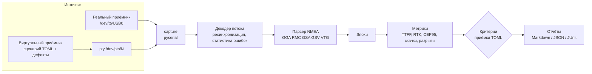

# gnss-testbench

Стенд для тестирования ПО и прошивок GNSS-приёмников. Принимает поток NMEA 0183 с
последовательного порта, оценивает качество навигационного решения (TTFF, RTK, точность,
целостность потока) и проверяет его по критериям приёмки. Для работы без железа в комплекте
есть виртуальный приёмник со сценариями и внесением дефектов.

```
$ gnss-testbench run scenarios/urban_canyon.toml --criteria criteria/rtk_static.toml
...
FAIL  Доля RTK fixed после фиксации: 0.8276 (порог >= 0.95) — FAIL
FAIL  Потери RTK fixed: 1 шт. (порог <= 0 шт.) — FAIL
FAIL  Скачки координат: 2 шт. (порог <= 0 шт.) — FAIL
FAIL  Горизонтальная ошибка CEP95: 0.0712 м (порог <= 0.03 м) — FAIL
```

## Архитектура



| Модуль | Назначение |
|---|---|
| `nmea/parser.py` | Строгий парсер: контрольная сумма, обрамление, все поля с проверкой диапазонов. Ошибки разделены на `FramingError`, `ChecksumError` и `FieldError` |
| `nmea/stream.py` | Сборка строк из байтового потока: куски любой длины, мусор, оборванные и слишком длинные строки |
| `analysis/metrics.py` | TTFF, время до RTK fixed, доступность, доля RTK fixed, потери фиксации, разрывы потока, скачки координат, CEP50/CEP95, систематический сдвиг, PDOP |
| `analysis/criteria.py` | Пороги из TOML (`ttff_max_s`, `cep95_max_m` и т. д.). Опечатка в имени критерия — ошибка, а не молча зелёная проверка |
| `analysis/report.py` | Markdown для людей, JSON для машин, JUnit XML для вкладки Tests в GitLab |
| `sim/` | Виртуальный приёмник: фазы решения, шум, систематический сдвиг, пропадание данных, битые суммы, обрывы, мусор, ложная фиксация. Выдача в pty |
| `capture.py` | Запись с порта — реального или виртуального |

## Быстрый старт

```bash
python -m venv .venv && source .venv/bin/activate
make install          # pip install -e ".[dev]"
make test             # 240 тестов, около 25 с
make acceptance       # 4 сценария с ожидаемыми вердиктами
```

Виртуальный приёмник в «настоящем» порту:

```bash
gnss-testbench serve scenarios/open_sky_rtk.toml
# Виртуальный приёмник «Открытое небо: холодный старт и RTK» вещает в /dev/pts/3
picocom -b 115200 /dev/pts/3        # в другом терминале
```

Реальный приёмник:

```bash
scripts/capture.sh -p /dev/ttyUSB0 -d 300 -c criteria/rtk_static.toml -r 55.6948,37.36125
pytest -m hardware --gnss-port /dev/ttyUSB0
```

## Сценарии

| Сценарий | Что моделирует | Критерии | Ожидание |
|---|---|---|---|
| `open_sky_rtk` | Холодный старт → GPS → RTK float → RTK fixed, σ = 8 мм | `rtk_static` | ✅ пройдена |
| `noisy_serial` | 10 Гц, мусор в порту, искажённые байты, оборванные строки | `serial_robustness` | ✅ пройдена |
| `urban_canyon` | Многолучёвость, срыв фиксации, ложная фиксация на 1 м | `rtk_static` | ❌ провалена |
| `tunnel_dropout` | 5 Гц, приёмник молчит 12 с, повторная сходимость | `rtk_static` | ❌ провалена |

Негативные сценарии проверяют сам стенд: если сценарий с дефектами вдруг прошёл приёмку,
значит, стенд перестал ловить дефекты, и конвейер падает (`scripts/acceptance.sh`).

## Тестирование

| Уровень | Кол-во | Что проверяет |
|---|---|---|
| Unit | ~220 | Эталонные строки, классы эквивалентности, граничные значения, метрики на данных с известным ответом |
| Property-based (hypothesis) | 10 | Парсер не падает ни на каком вводе; любое искажение одного байта ловится; декодер не зависит от нарезки потока |
| Интеграционные | 9 | Эмулятор → pty → pyserial → анализ → приёмка, побайтное совпадение отправленного и принятого |
| Аппаратные | 5 | Реальный приёмник на стенде (`--gnss-port`) |

Покрытие веток — около 96 %, `mypy --strict` без ошибок.

Документация QA:
- [План тестирования](docs/test-plan.md): уровни, техники, окружение, критерии приёмки и их обоснование, риски.
- [Тест-кейсы](docs/test-cases.md): трассировка требований на автотесты.
- [Найденные дефекты](docs/bug-reports.md): три настоящих бага, найденных тестами при разработке, в формате баг-репорта.

## CI

`.gitlab-ci.yml`:

```
lint (ruff, mypy, shellcheck) → test (unit, integration) → acceptance (матрица сценариев) → hardware (раннер gnss-bench)
```

- JUnit-отчёты тестов и критериев приёмки выводятся во вкладке **Tests**, покрытие — в merge request.
- Ошибки `ruff` публикуются как Code Quality.
- `acceptance` — `parallel:matrix`: каждый сценарий идёт отдельным job, отчёты сохраняются в артефактах.
- `hardware-smoke` запускается на раннере с подключённым приёмником: вручную или по расписанию.

Для GitHub то же самое описано в `.github/workflows/ci.yml`, тесты гоняются на Python 3.11–3.13.

## Docker

```bash
docker build -t gnss-testbench .
docker run --rm gnss-testbench run scenarios/open_sky_rtk.toml --criteria criteria/rtk_static.toml
docker run --rm --device /dev/ttyUSB0 -v "$PWD/logs:/data" gnss-testbench \
    capture --port /dev/ttyUSB0 --duration 300 -o /data/receiver.nmea
```

## Термины

- **TTFF** (Time To First Fix) — время от включения до первого навигационного решения.
- **RTK fixed / float** — решение по фазе несущей с поправками от базовой станции. Fixed — целочисленная
  неоднозначность фазы разрешена, точность сантиметровая. Float — не разрешена, точность дециметровая.
- **Ложная фиксация** — неоднозначность разрешена неверно. Приёмник сообщает fixed, но координаты
  смещены на дециметры и больше. Проявляется скачком координат.
- **CEP50 / CEP95** — радиус круга, в который попадает 50 % / 95 % горизонтальных ошибок.
- **PDOP** — геометрический фактор снижения точности: чем лучше спутники разнесены по небу, тем он меньше.
